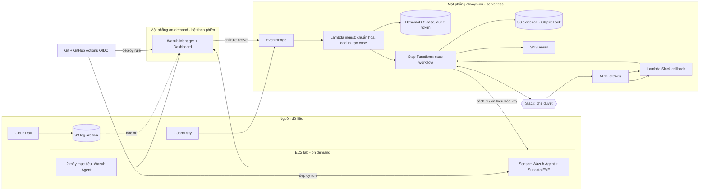

# SIEM/SOAR trên AWS: Wazuh + GuardDuty + Suricata với quy tắc phát hiện quản lý bằng mã

Đồ án chuyên ngành (UIT – Khoa Mạng máy tính và Truyền thông) · Nguyễn Đoàn Hồng Huy · 23520628 · NT114.R11

Hệ thống SIEM/SOAR quy mô lab trên **một tài khoản AWS**: gom cảnh báo **cloud** (GuardDuty/CloudTrail), **host**
(Wazuh Agent: log, FIM, xác thực) và **network** (Suricata IDS) vào **một lớp case thống nhất**, tự động hóa quy trình
xử lý **luôn có người phê duyệt** (Slack, dự phòng SNS email + CLI), có cách ly – xác minh – khôi phục – audit, và
**rule được quản lý như code** (Git → PR → test tự động → shadow → active → rollback).

> Bản mô tả đầy đủ (Việt) ở [`docs/`](docs/). Đề cương gốc là nguồn yêu cầu; những chỗ code cụ thể hóa hoặc đi chệch
> khỏi đề cương được ghi ở mục [Ánh xạ đề cương ↔ code](#ánh-xạ-đề-cương--code).

## Kiến trúc



Chi tiết: [docs/architecture.md](docs/architecture.md).

## Những gì có trong repo

| Thư mục | Nội dung |
|---|---|
| `infra/bootstrap` | State bucket + OIDC GitHub↔AWS với 3 role (plan chỉ đọc, apply theo Environment, rules least-privilege) |
| `infra/modules/serverless-core` | Mặt phẳng always-on: DynamoDB, S3 (evidence Object Lock, CloudTrail, rules), GuardDuty, CloudTrail, EventBridge+DLQ, 9 Lambda (role riêng, least privilege), Step Functions, API Gateway, SSM params, alarm, Budgets, timer tự tắt |
| `infra/modules/lab-ondemand` | Mặt phẳng on-demand: VPC không cổng vào, Wazuh all-in-one (`t3a.xlarge`, đạt khuyến nghị Wazuh), sensor (Wazuh Agent + Suricata), `target_count` máy mục tiêu (mặc định 2, **IAM role riêng từng máy**), IMDSv2, SSM document deploy rule, IAM victim user |
| `agent/` | Cài Wazuh Agent dùng chung cho mọi máy lab: cấu hình FIM, **auditd** (rule theo tài liệu Wazuh, `siemsoar.rules`), bootstrap máy mục tiêu |
| `src/lambdas/siemsoar` | Thư viện lõi: schema chuẩn hóa **điều khiển bằng `policy.toml`** (thang severity, ánh xạ response/ATT&CK, trường ngữ cảnh, khóa dedup, trọng số rủi ro: ATT&CK của GuardDuty lấy từ MITRE CTID qua `guardduty_attack.json`; giá trị còn lại ghi rõ nguồn hoặc `basis = "analyst"`), store DynamoDB (state machine case, dedup nguyên tử, token một lần, circuit breaker), Slack, evidence, response (EC2 mọi ENI / IAM) |
| `src/lambdas/handlers` | Lambda handler: `ingest`, `enrich`, `notify`, `slack_interact`, `preflight`, `save_state`, `contain`, `restore`, `case_ops` (stop instance / disable key / audit rows là **SDK integration** của Step Functions, không phải Lambda) |
| `statemachine/` | Case workflow (sinh bởi `tools/gen_asl.py`, có `--check` trong CI) |
| `rules/` | Wazuh XML, Suricata rules, **metadata YAML** (state, MITRE, `wraps` = rule Wazuh chính thức mà rule này đứng trên, FP kỳ vọng, test dương/âm), `reference/` = **ảnh chụp có ghim phiên bản** của ATT&CK (STIX chính thức) và ruleset Wazuh 4.14.8 kèm SHA-256 nguồn |
| `tools/` | `rulesctl` (lint/lifecycle/build/promote/coverage/tune), `wazuh_logtest` (mọi test rule Wazuh chạy trên engine Wazuh thật: logtest API + hàng đợi analysisd cho FIM), `suricata_pcap_test` (mọi test rule Suricata chạy trên Suricata thật), `capture_pcaps` (bắt pcap từ thủ tục Atomic chạy thật trong Docker, kèm provenance), `release`, `labctl` (bật/tắt lab + timer; `ensure-timer` sau mỗi apply; `refresh-agents` áp cấu hình agent mới lên máy đang chạy), `soarctl` (`decide`, `recover`: cổng người), `observe_alerts` (mọi alert một lượt chạy đã sinh, kể cả rule chính thức: bằng chứng để viết rule mới), `export_evidence`, `gen_asl`, `refdata` (dựng ảnh chụp tham chiếu), `refcheck` (mọi link được trích dẫn còn sống), `eve_logtest` (Suricata thật → EVE thật → logtest Wazuh thật: kiểm tra rule ánh xạ, group, MITRE) |
| `wazuh/`, `suricata/`, `scripts/` | Bootstrap manager/agent/sensor, integration `custom-eventbridge`, `deploy_rules.sh` (kiểm tra + tự rollback trên host) |
| `simulation/` | 33 kịch bản có ground truth: 24 lượt Atomic Red Team dùng **21 test công khai** (14 kỹ thuật host/mạng, gồm kịch bản xuyên máy), Stratus (AWS), GuardDuty sample, 4 kịch bản lành tính/vòng đời, 3 robustness + runner (chặn chạy trên máy đang bị cô lập); kịch bản vòng đời rule chạy qua pipeline CI/CD (xem `docs/detection-as-code.md`) |
| `evaluation/` | Tính chỉ số của đề cương từ dữ liệu thật. Số giờ lab, baseline thủ công và chi phí đọc từ **CloudTrail, GuardDuty, Cost Explorer, AWS Pricing API** (`sources.py`), không nhập tay, không hằng số giá |
| `tests/` | 330+ test (moto): unit, workflow end-to-end chạy **đúng ASL thật** với handler thật; `tests/contract` kiểm ASL bằng **TestState API** của AWS (chạy khi có `RUN_TESTSTATE=1`) |
| `.github/` | CI, Terraform plan/apply, `rules-deploy`, `lab-session`, PR template |

## Bắt đầu nhanh

```bash
make install && make all          # lint + ASL + test + rules + terraform validate
```

Triển khai thật (chi tiết từng bước, kể cả tạo Slack App: [docs/runbook.md](docs/runbook.md)):

1. `infra/bootstrap` → `terraform apply -var github_repo=<user>/SIEM-SOAR-LAB` (chạy local một lần).
2. Tạo GitHub **variables** `TFSTATE_BUCKET, PLAN_ROLE_ARN, APPLY_ROLE_ARN, RULES_ROLE_ARN` (+ `AWS_REGION` nếu khác us-east-1), **secret** `ALERT_EMAIL`, và **environments** `lab`, `lab-rules` (bật required reviewers).
3. Merge → workflow `terraform` apply. Mặc định `dry_run=true`: workflow chạy trọn vẹn nhưng chưa thay đổi EC2/IAM.
4. Đặt secret Slack vào SSM (không qua Terraform state), xác nhận email SNS.
5. Actions → **lab-session** → `up` (bật Wazuh + EC2 lab, tự tắt sau N giờ).
6. `python -m simulation.runner run host-useradd` (Atomic Red Team T1136.001 thật) rồi `python -m evaluation.evaluate`.

## Trạng thái kiểm chứng (trung thực)

| Hạng mục | Đã kiểm chứng bằng | Chưa kiểm chứng |
|---|---|---|
| Logic case, dedup, token một lần, double-click, breaker, fail-safe, restore (mọi ENI), IAM key rotation idempotent, phân giải agent→instance | 330+ test với moto, workflow chạy đúng ASL + handler thật | Hành vi AWS thật (moto không mô phỏng hết ràng buộc IAM/SG) |
| Rule Suricata | `suricata -T` + replay pcap **bắt từ thủ tục Atomic thật** bằng **Suricata thật** với rule ET Open ghim; pcap lành tính không được kích hoạt rule active; `eve_logtest`: alert EVE thật → rule Wazuh thật (id khai trong metadata, group `siemsoar_<state>`, MITRE) | Độ nhiễu trên traffic production |
| Rule Wazuh | Job CI `wazuh-engine`: `wazuh-analysisd -t` + mọi test trong metadata (log thô qua logtest API, sự kiện FIM qua hàng đợi analysisd) trên image Wazuh 4.14.8 chính thức; chạy tay 59/59 PASS (20/10/2026), kể cả rule bọc rule chính thức 5763/5712 với đúng ngưỡng 8 sự kiện và sự kiện FIM *who-data* | Hành vi theo thời gian thật của `frequency/timeframe` (engine đếm theo thời điểm nhận) |
| Terraform | `fmt`, `validate`, `terraform test`; **apply thật** qua GitHub Actions (OIDC, environment có người duyệt) | - |
| Bootstrap Wazuh/Suricata | `bash -n` + shellcheck; **chạy thật** trên EC2 Ubuntu (Wazuh 4.14.8, Suricata 7.0) | - |
| Toàn hệ thống trên AWS thật (phiên lab 17–19/10/2026) | Atomic/Stratus → Wazuh/GuardDuty → case → Slack → người duyệt → cách ly EC2 / vô hiệu key IAM thật → evidence → restore; rollback rule shadow ↔ active; robustness (double-click, Slack hỏng, lỗi giữa chừng); **nhiều máy**: kịch bản xuyên máy, cô lập đúng một máy mục tiêu và chỉ role riêng của nó (kiểm bằng CloudTrail) | Baseline thủ công (chưa diễn tập); số lượt còn nhỏ (báo cáo in khoảng tin cậy 95%) |
| Telemetry auditd | Cài trên mọi máy lab, rule đúng dạng tài liệu Wazuh; manager nhận alert chính thức 80792 từ cả 3 agent, `events_dropped = 0` | Rule audit 100143–100145 mới ở shadow, FP đo trên ít lượt lành tính (khoảng tin cậy rộng); lượng log nền chỉ đo lúc máy rảnh (~2,6 alert/phút/máy) |

Nghĩa là: logic được test tự động, và luồng đầu-cuối đã chạy trên AWS thật với quyết định của người. Số liệu nằm trong
`reports/` (sinh từ DynamoDB/CloudTrail, không nhập tay); giới hạn ở [docs/limitations.md](docs/limitations.md).

## Nguồn gốc dữ liệu (không bịa)

| Loại dữ liệu | Nguồn | Ghi chú |
|---|---|---|
| Phát hiện host | Rule Wazuh **chính thức** (550, 5902, 5712, 5763 …) làm gốc; rule SIEMSOAR chỉ đứng trên chúng (`<if_sid>`), không tự đếm lại ngưỡng | `rulesctl lint` kiểm mọi rule cha có trong ruleset Wazuh 4.14.8 đã ghim (`rules/reference/wazuh-4.14.8.json`) và id tùy biến không trùng id chính thức |
| ATT&CK | STIX chính thức của MITRE (v20.0) ghim trong `rules/reference/` | lint từ chối id không tồn tại, đã **revoked** (T1562.008 → T1685.002) hoặc deprecated. GuardDuty không công bố ánh xạ ATT&CK nên dùng ánh xạ độc lập của **MITRE CTID (Mappings Explorer / AWS, 12/2024)**, ghim theo commit + SHA-256 và sinh bằng `python -m tools.refdata guardduty` (id bị thu hồi được đổi theo quan hệ `revoked-by` của ATT&CK). Finding type CTID không liệt kê thì để trống, không đoán; ghi đè cục bộ phải kèm `basis` + `reason` |
| Tham chiếu trích dẫn | `python -m tools.refcheck` (CI hằng tuần) kiểm mọi URL còn sống | 18/18 hợp lệ khi kiểm |
| Phát hiện mạng | **Emerging Threats Open** (rule cộng đồng, BSD) được chọn qua metadata, nội dung ghim theo bản phát hành ET (`rules/reference/et-open-managed.json`) | không còn chữ ký tự viết khớp pcap tự dựng |
| Tấn công mô phỏng | Atomic Red Team (YAML gốc, ghim commit, 21 test của 14 kỹ thuật; chỉ mục Linux có 423 test / 113 kỹ thuật, không có test Linux nào thuộc tactic lateral-movement), Stratus Red Team (`cloudtrail-stop`, finding GuardDuty theo tài liệu Stratus), GuardDuty sample finding (đánh dấu `pipeline_only`); một thủ tục lab tự viết (`host-ssh-burst-existing`) được ghi rõ là không làm bằng chứng | kỹ thuật ATT&CK của kịch bản **được suy ra** từ chỉ mục ART / CTID / provenance pcap, không gõ tay; không còn event/finding bơm giả |
| Nhãn ATT&CK của rule | MITRE trên rule Wazuh chính thức được bọc, hoặc thủ tục Atomic/Stratus đã kích hoạt rule | `rulesctl lint` từ chối nhãn không có nguồn và kịch bản mâu thuẫn với nhãn của rule |
| Danh mục finding GuardDuty | trang "Active/Retired finding types" + lịch sử tài liệu của AWS (`rules/reference/guardduty-finding-types.json`) | tên finding trong CTID và trong kịch bản phải là tên AWS công bố; đổi tên theo đúng câu "has been changed to" của AWS |
| Telemetry host | syslog/auth (cấu hình mặc định của agent), FIM, **auditd** (rule `execve` theo euid 0 và theo dõi đọc `/etc/shadow`, đúng dạng [tài liệu Wazuh](https://documentation.wazuh.com/current/user-manual/capabilities/system-calls-monitoring/use-cases/monitoring-commands-run-as-root.html)), Suricata EVE (sensor) | alert do rule chính thức của ruleset ghim sinh ra (80780–80792 cho audit) |
| Số đo | CloudTrail (giờ lab, hành động cách ly thủ công), GuardDuty (thời điểm finding), Cost Explorer (chi phí thật theo tag `Project`), Pricing API (giá niêm yết) | thiếu quyền/thẻ chưa kích hoạt thì báo "không lấy được", không điền số |
| **Fixture (không phải bằng chứng phát hiện)** | dòng log mẫu trong metadata Wazuh và sự kiện FIM tiêm vào hàng đợi analysisd; pcap Suricata bắt từ thủ tục Atomic chạy trong Docker (`rules/pcaps/provenance.json`: lệnh, digest image, SHA-256) | unit-test rule trên engine thật; kết quả không đưa vào chỉ số TP/FP. Chất lượng phát hiện chỉ lấy từ các lượt chạy trên lab |

## Ánh xạ đề cương ↔ code

| Đề cương | Hiện thực |
|---|---|
| 4.1 Hai mặt phẳng | `serverless-core` (always-on) / `lab-ondemand` (+ `labctl`, timer tự tắt bằng EventBridge Scheduler gọi thẳng `ec2:StopInstances`, Budgets) |
| 4.2 Bảng thành phần | Wazuh/Agent (`wazuh/`, `suricata/`), GuardDuty/CloudTrail (`guardduty.tf`, `cloudtrail.tf`), EventBridge, Step Functions, DynamoDB, Slack+SNS, GitHub Actions |
| 4.3 Hình 2 – vòng đời rule | `rulesctl lint/test/lifecycle/build/promote`, `rules-deploy.yml`, `release rollback` |
| 4.3 Hình 3 – luồng phát hiện→phản ứng | `statemachine/case_workflow.asl.json` |
| 4.3 Hình 4 – trạng thái case | `siemsoar/states.py` (+ `ACKNOWLEDGED` cho case không có hành động phản ứng) |
| 4.3 Hình 5 – vùng security/workload/simulation | tag `siemsoar:zone`, IAM điều kiện theo tag, tiền tố `lab-` cho IAM user |
| 4.4 Nguyên tắc | managed first, everything as code, human approval, fail-safe, cost awareness (xem `docs/architecture.md`) |
| 5.2 nhóm 1–8 | bootstrap OIDC; Wazuh/agent; CloudTrail→S3 + GuardDuty→EventBridge; rule as code; case workflow/Slack/task token; response/restore; simulation/ground truth; vận hành/teardown (`export_evidence`) |
| 5.4 Kịch bản | `simulation/scenarios/*.yml` |
| 6.2 Chỉ số | `evaluation/evaluate.py` |
| 6.3 Baseline | `evaluation/sources.py` (CloudTrail: lệnh cách ly từ Console của người) + `evaluate` so cùng khoảng finding → ngăn chặn |
| 6.5 Giới hạn | [docs/limitations.md](docs/limitations.md) |

**Điểm khác/bổ sung so với đề cương** (có chủ đích): (1) Wazuh đẩy alert *active* lên EventBridge bằng integration tự
viết `custom-eventbridge` (không qua webhook công khai); (2) thêm trạng thái `ACKNOWLEDGED`; (3) cổng phê duyệt **thứ hai**
cho bước restore (hình 3: "thực sự mối đe dọa?" → restore TP/FP); (4) rotate key bằng Secrets Manager khi xác nhận bị lộ;
(5) circuit breaker + `dry_run` + fault-injection để chứng minh robustness; (6) kênh quyết định dự phòng `soarctl`
(dùng thông tin xác thực AWS, không thể giả mạo qua email); (7) giảm FP bằng **rule ngoại lệ dựa trên log thật**
(100112: tài khoản dịch vụ `nologin`; 100146: file cron do `dpkg` dưới `apt-get` ghi, theo FIM *who-data*), không sửa thẳng rule đang active; (8) **nhiều máy mục tiêu**, mỗi máy một IAM role
để cô lập một máy không cắt phiên của máy khác; (9) telemetry **auditd** để bắt biến thể không đi qua log của công cụ.
