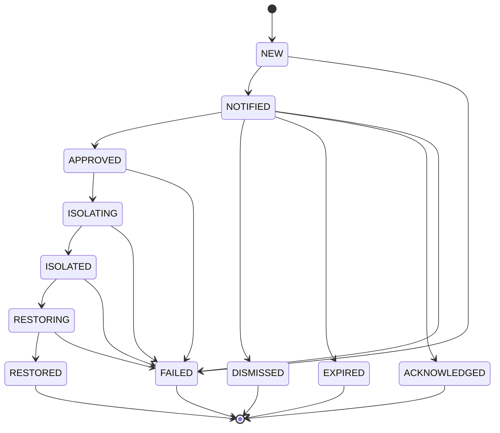

# Kiến trúc chi tiết

## 1. Hai mặt phẳng

| | Always-on (serverless) | On-demand (bật theo phiên) |
|---|---|---|
| Thành phần | CloudTrail→S3, GuardDuty, EventBridge(+DLQ), Lambda, Step Functions, DynamoDB, S3 evidence, SNS, API Gateway | VPC lab, Wazuh Manager+Indexer+Dashboard, EC2 sensor (Wazuh Agent + Suricata), `target_count` máy mục tiêu (mặc định 2; Wazuh Agent, **IAM role riêng từng máy**, SSH chỉ mở từ sensor) |
| Kịch bản xuyên máy | | Test Atomic công khai chạy từ sensor nhắm vào máy mục tiêu (`xhost-*`: T1046, T1110.004); `observe_on` chỉ máy mà phát hiện được kỳ vọng. Atomic Red Team (commit đã ghim) **không có** test Linux thuộc tactic lateral-movement (tra từ ATT&CK v20 + chỉ mục ART), nên không có kịch bản lan truyền ngang tự viết |
| Chi phí | Trả theo dùng (~vài USD/tháng khi nhàn rỗi; GuardDuty tính theo khối lượng) | Chỉ tính khi bật; `tools.labctl` bật lab và đặt timer tự tắt: EventBridge Scheduler gọi thẳng `ec2:StopInstances` (không Lambda). Timer giữ danh sách máy lúc hẹn, nên sau mỗi apply workflow chạy `labctl ensure-timer` (hẹn lại đúng giờ cũ với mọi máy lab; có máy chạy mà không có timer thì hẹn 1 giờ) |
| Khi tắt | Cloud path (GuardDuty) vẫn tạo case | Telemetry host/Suricata có khoảng trống; CloudTrail trong S3 được Wazuh đọc bù khi bật lại |
| Terraform | `infra/modules/serverless-core` | `infra/modules/lab-ondemand` (`count = lab_enabled ? 1 : 0`) |

### Telemetry trên máy lab
| Nguồn | Máy | Cấu hình | Alert |
|---|---|---|---|
| syslog / auth.log | mọi máy | mặc định của Wazuh Agent (không khai lại để tránh đọc trùng) | rule chính thức (5902, 5710/5712, 5763, …) → rule SIEMSOAR bọc |
| FIM (real-time, theo thư mục + `restrict`) | mọi máy | `agent/ossec_agent_additions.xml`: `/etc/passwd`, `shadow`, `sudoers`, `sshd_config`, `authorized_keys`, cron, systemd, profile/bashrc, thư mục canary | 550/554 → rule SIEMSOAR |
| auditd | mọi máy | `agent/siemsoar.rules`: `execve` theo euid 0 (b64/b32), đọc `/etc/shadow`, `/etc/gshadow`; key theo danh sách `audit-keys` của Wazuh | rule chính thức 80780–80792 (80792 "Audit: Command") |
| Suricata EVE | sensor | `suricata/ossec_eve_localfile.xml` | 86601 → rule ánh xạ SIEMSOAR (110101–110103) |

Cấu hình agent đổi trong repo đến máy đang chạy bằng `labctl refresh-agents` (cùng script cài đặt, idempotent; không
chạm manager). Bootstrap chỉ chạy lúc khởi động lần đầu.

## 2. Luồng dữ liệu

```mermaid
sequenceDiagram
  autonumber
  participant S as Nguồn (GuardDuty / Wazuh+Suricata)
  participant EB as EventBridge
  participant I as Lambda ingest
  participant D as DynamoDB
  participant W as Step Functions
  participant H as Người phê duyệt (Slack / soarctl)
  participant R as AWS (EC2 / IAM)
  S->>EB: finding / alert (Wazuh: chỉ rule active)
  EB->>I: sự kiện (retry + DLQ)
  I->>D: first_delivery? dedup lock nguyên tử?
  alt trùng
    I->>D: tăng alert_count + audit (không tạo case mới)
  else mới
    I->>D: tạo case NEW
    I->>W: StartExecution(name = case_id)
  end
  W->>W: Enrich: risk score, tồn tại tài nguyên?
  W->>H: Thẻ Slack (chỉ case_id|gate|decision) + SNS. Task token lưu server-side
  H->>D: click → HMAC + allow-list + transition NOTIFIED→APPROVED (điều kiện) + consume token (1 lần)
  H->>W: SendTaskSuccess
  W->>R: Preflight (scope, tag, DryRun IAM, circuit breaker)
  W->>R: Lưu pre-action state (S3, ghi một lần, sha256)
  W->>R: Snapshot → SG cô lập (không ingress; egress chỉ 1514 tới Wazuh manager) → revoke session → (stop nếu rủi ro cao)
  W->>R: Verify bằng API → ISOLATED
  W->>H: Cổng 2: Restore (TP: đã khắc phục / FP)
  W->>R: Validate (không alert mới, không drift) → Restore → Verify → RESTORED
```

## 3. Trạng thái case



Mọi chuyển trạng thái là một `UpdateItem` **có điều kiện** (`status IN (...)`) nên double-click, retry của Lambda hay
hai kênh quyết định (Slack + CLI) đồng thời chỉ có một kết quả hợp lệ. Mỗi chuyển trạng thái ghi một dòng audit bất biến.

## 4. Mô hình dữ liệu (DynamoDB một bảng)

| pk | sk | Nội dung |
|---|---|---|
| `CASE#<id>` | `META` | case: nguồn, rule, tài nguyên, severity, risk, plan, thời điểm từng bước, `containment_seconds`, `evidence_seconds`, `verdict` |
| `CASE#<id>` | `AUDIT#<ts>#<n>` | audit (ai, làm gì, khi nào, chi tiết) – chỉ ghi thêm |
| `CASE#<id>` | `TOKEN#approval|restore` | task token Step Functions, `used`, TTL (không bao giờ gửi cho Slack) |
| `DEDUP#<key>` | `LOCK` | khóa cửa sổ dedup → `case_id` |
| `ALERT#<id>` | `SEEN` | idempotency cho EventBridge at-least-once |
| `BREAKER#isolation` | `BUCKET#<n>` | tập case_id trong cửa sổ (đếm idempotent) |
| `RUN#<id>` | `META` | lượt mô phỏng + ground truth + kết quả |

GSI: `resource-index (resource_id, created_at)`, `status-index (status, created_at)`.

## 5. Mô hình bảo mật

* **Không có cổng vào**: VPC lab không có inbound; quản trị bằng SSM Session Manager; dashboard qua port-forward.
* **OIDC, không khóa dài hạn**: role `plan` (ReadOnly, chỉ `pull_request`), `apply` (chỉ job gắn Environment `lab`, cần reviewer duyệt), `rules` (chỉ upload S3 + SSM SendCommand tới instance gắn tag `ondemand`).
* **SOAR không thể vượt phạm vi**: IAM của Lambda giới hạn thao tác ghi EC2 trên instance có tag `siemsoar:zone=workload`, IAM user có tiền tố `lab-`, role `siemsoar-lab-*`; Wazuh manager gắn `siemsoar:protected=true`. Phạm vi được xét hai lần: **enrich** (trước khi hỏi người duyệt) hạ kế hoạch ngoài phạm vi xuống *chỉ thông báo* (thẻ Acknowledge/Dismiss, không đề xuất hành động mà preflight sẽ từ chối, không đọc IAM user ngoài tiền tố); **preflight** (sau khi duyệt) kiểm lại vì tag có thể đổi trong lúc chờ.
* **Nhiều máy, phạm vi riêng**: mỗi máy mục tiêu có IAM role `siemsoar-lab-target-N` riêng; thu hồi phiên khi cô lập chỉ chạm role của máy đó (đã kiểm trên lab bằng CloudTrail). Máy mục tiêu chỉ mở SSH từ sensor cho các test xuyên máy.
* **GuardDuty**: thời điểm sự kiện là `service.eventLastSeen` (hoạt động đã kích hoạt lần gửi này; finding lặp lại không bị đo từ lần đầu). Key `ASIA…` là credential tạm của STS ([IAM unique-id prefixes](https://docs.aws.amazon.com/IAM/latest/UserGuide/reference_identifiers.html#identifiers-unique-ids)): gộp theo danh tính, không bao giờ đề xuất `iam_key_disable` (không vô hiệu được bằng `UpdateAccessKey`).
* **Slack**: HMAC (cửa sổ 5 phút), allow-list người duyệt trong SSM, token ở server, nút chỉ mang `case_id|gate|decision`.
* **Secret**: SSM SecureString (đặt ngoài Terraform), key xoay vòng ghi vào Secrets Manager, không bao giờ vào state/log/DynamoDB (có test).
* **Evidence**: S3 Versioning + Object Lock (GOVERNANCE) + SSE + TLS-only; ghi một lần, hash trong case, kiểm lại hash trước restore.
* **Log Step Functions** không chứa payload (`include_execution_data=false`).

## 5b. Chính sách là dữ liệu
`src/lambdas/siemsoar/policy.toml` (đóng gói cùng Lambda, nạp và **kiểm tra** lúc khởi động bằng `tomllib`) chứa mọi phán đoán có thể thay đổi: thang severity của GuardDuty/Wazuh, finding nào được kèm response nào (theo `resourceType`/`userType`), ánh xạ ATT&CK (lấy từ MITRE CTID qua `guardduty_attack.json`, ghi đè cục bộ phải có `basis` + `reason`), trường ngữ cảnh lấy từ alert gốc (đường dẫn có thứ tự: `data.src_ip` rồi `data.srcip` …), khóa dedup, thứ tự phân giải agent→instance (`instance_id`, `private_ip`, `name_tag`; chỉ nhận khi **đúng một** kết quả) và trọng số rủi ro. Đổi nguồn dữ liệu hay chính sách = sửa file này, không sửa code; test kiểm file hợp lệ và mọi ID ATT&CK còn hiệu lực.

### Tham số vận hành: quyết định thiết kế, không phải số đo
Các giá trị dưới đây không có nguồn công bố. Chúng là lựa chọn của người vận hành, đặt trong Terraform
(`infra/modules/serverless-core/variables.tf`) và được ghi lại ở đây kèm lý do và cách kiểm chứng.

| Tham số | Giá trị | Lý do | Kiểm bằng |
|---|---|---|---|
| `approval_timeout_seconds` | 3600 | Một người trực có một giờ để quyết định; hết giờ thì case `EXPIRED`, không tự hành động (fail-safe) | Số đo `approval_wait_s` (lab: p50 91 s, max 690 s) |
| `restore_timeout_seconds` | 86400 | Tài nguyên bị cách ly chờ quyết định khôi phục tối đa 1 ngày rồi giữ nguyên trạng thái an toàn | Robustness `mid-failure` |
| `dedup_window_seconds` | 3600 | Alert cùng khóa trong 1 giờ gộp vào một case đang mở | `alert_duplication_reduction` |
| `breaker_limit` / `breaker_window_seconds` | 3 / 3600 | Quá 3 lần cách ly mỗi giờ thì nghi rule nhiễu: tự động dừng, chờ người | Test `circuit_breaker` |
| `stop_risk_threshold` | 85 | Chỉ stop máy khi rủi ro rất cao; SG stateful không cắt kết nối cũ (xem limitations) | Case lab: risk 65 → không stop |
| `[risk]`, `[severity]` trong `policy.toml` | `basis = "analyst"` | Xếp thứ tự xử lý, không quyết định có hành động hay không | FP/TP đo được, `rulesctl tune` |
| Máy manager `t3a.xlarge`, đĩa 50 GB | 4 vCPU, 16 GiB | Đạt khuyến nghị Wazuh all-in-one cho 1–25 agent (4 vCPU, 8 GiB, 50 GB; [quickstart](https://documentation.wazuh.com/current/quickstart.html)). `t3.large` (2 vCPU) thấp hơn khuyến nghị, dù lab đo không quá tải | CloudWatch CPU/credit, `free`, PSI, `events_dropped` của analysisd |
| Máy sensor `t3.small` | 2 vCPU, 2 GiB | Đo trên lab: Suricata dùng khoảng 560 MB, còn khoảng 1 GB trống, không mất gói (`capture.kernel_drops`), không OOM. Không có khuyến nghị cấu hình chính thức để đối chiếu | như trên |
| `settle_seconds` của kịch bản | 90–300 s (host/mạng), 1800 s (Stratus) | Thời gian runner chờ trước khi kết luận | `window_headroom` trong báo cáo (lab: phát hiện host muộn nhất < 1 s sau khi chạy xong) |

## 6. Nguyên tắc thiết kế → hiện thực

| Nguyên tắc | Hiện thực |
|---|---|
| Managed first | Dịch vụ AWS quản lý; thao tác một lệnh API (`ec2:StopInstances`, `iam:UpdateAccessKey`, ghi audit DynamoDB) chạy bằng **SDK integration** của Step Functions với Retry/Catch gốc; chỉ phần có logic (preflight, cô lập SG, restore, xác minh) mới là Lambda (boto3 + stdlib) |
| Everything as code | Terraform, rule + metadata, workflow (sinh bằng `gen_asl`), pipeline |
| Human approval | 2 cổng (containment, restore); hết hạn → `EXPIRED`, không làm gì |
| Fail safe | Lỗi giữa chừng → giữ trạng thái an toàn đã đạt (không tự rollback), `FAILED` + SNS/Slack + alarm CloudWatch |
| Cost awareness | `labctl` + timer Scheduler, Budgets, PAY_PER_REQUEST, log 14 ngày, không NAT |
