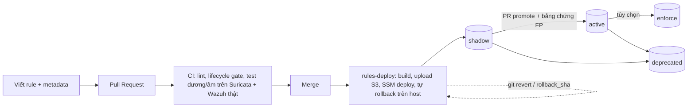

# Detection-as-Code

## Vòng đời rule (Hình 2 của đề cương)

| Trạng thái | Ý nghĩa | Wazuh | Suricata |
|---|---|---|---|
| `shadow` | Ghi nhận alert, **không** tạo case | rule được gắn group `siemsoar_shadow`; integration chỉ forward `siemsoar_active/enforce` | vẫn `alert` (EVE JSON), rule ánh xạ Wazuh mang state |
| `active` | Alert thành case và vào SOAR | `siemsoar_active` → EventBridge | như trên |
| `enforce` (tùy chọn) | Minh họa chặn trên host | như active | build đổi `alert`→`drop` khi `--allow-drop` (chỉ khi Suricata chạy inline) |
| `deprecated` | Gỡ khỏi bản build | bị loại | bị loại |

Các group `siemsoar_<state>` và `resp_<response>` **không viết tay**: `rulesctl build` chèn từ metadata (lint chặn việc viết tay),
nên trạng thái rule chỉ đổi được bằng một dòng `state:` trong PR.

## Nguyên tắc: không viết lại thứ Wazuh đã có
Rule SIEMSOAR hoặc **đứng trên** một rule chính thức (`<if_sid>5763</if_sid>`, `5712`, `5902`, `550` …: bộ đếm `frequency/timeframe` và regex vẫn là của Wazuh, SIEMSOAR chỉ quyết định mức độ, MITRE, state, response) hoặc là rule riêng của lab mà không rule chính thức nào biết (thư mục canary). Metadata khai `wraps: [...]` đúng bằng tập rule chính thức mà rule hang dưới; `rulesctl lint` kiểm tra điều đó cùng với việc mọi rule cha có trong `rules/reference/wazuh-<ver>.json` (dựng bởi `python -m tools.refdata wazuh`, kèm SHA-256 của tarball nguồn) và mọi id ATT&CK còn hiệu lực trong `rules/reference/attack-enterprise-<ver>.json` (`python -m tools.refdata attack`). Nâng phiên bản Wazuh = chạy lại `refdata` và xem diff.

## Nhãn ATT&CK phải có nguồn (không gán tay)
`rulesctl lint` từ chối mọi id ATT&CK trên một rule nếu nó không liên quan (trùng, hoặc là kỹ thuật cha/con) tới **một trong hai nguồn**:
1. MITRE mà chính Wazuh gắn trên các rule chính thức được bọc (`wraps`, đọc từ `rules/reference/wazuh-<ver>.json`), ví dụ 5712/5763 → T1110, 5902 → T1136;
2. một **thủ tục công khai** đã được chứng minh kích hoạt rule: kịch bản Atomic Red Team/Stratus Red Team kỳ vọng rule đó, hoặc pcap bắt từ thủ tục Atomic là test `match` của rule Suricata (`simulation/catalog.py:evidence`).

Ví dụ: 100103 (`/etc/sudoers`) mang T1548.003 vì Atomic T1548.003 #5 kích hoạt nó; đổi nhãn thành T1098 sẽ bị lint chặn với hai lỗi: nhãn không có nguồn và kịch bản `host-sudoers` mâu thuẫn với rule. 100102 (`/etc/shadow`) mang T1078.003 + T1136.001 vì đó là hai thủ tục Atomic thực sự làm đổi file này. Rule ET HUNTING 2034567 không mang kỹ thuật nào (`mitre: []`) vì không thủ tục tấn công nào được dùng làm bằng chứng cho nó.

## Rule mạng: ET Open được quản lý, không tự viết chữ ký
Phát hiện mạng lấy từ **Emerging Threats Open** (rule cộng đồng, BSD). Metadata `source: et-open` chọn sid, `wazuh_rule_id` khai **tường minh** id rule Wazuh sinh ra (không tính từ sid). `python -m tools.refdata et-open` ghim nội dung rule đó (phiên bản ET, SHA-256 bản phát hành) vào `rules/reference/et-open-managed.json`; bản build đưa nội dung ghim vào `siemsoar.rules` và sinh `disable.conf` để `suricata-update` bỏ bản trôi nổi của các sid này. Có thể bật rule ET mặc định tắt (ví dụ 2009582 `NMAP -sS window 1024`), vẫn bắt đầu ở shadow. Rule cục bộ (`rules/suricata/*.rules`, sid 9000000–9099999, msg bắt đầu `SIEMSOAR`) vẫn được hỗ trợ.

## Kỹ thuật mới: quan sát trước, rule sau
1. Chọn test công khai trong chỉ mục Atomic Red Team đã ghim (`rules/reference/atomic-red-team-linux.json`), kiểm YAML gốc: không `dependencies`, có cleanup, không phá hoại.
2. Kịch bản với `expect: []` (**quan sát**): báo cáo ghi kỹ thuật là *đã chạy, chưa phát hiện*.
3. `python -m tools.observe_alerts <run_id>`: mọi alert lượt đó sinh trên máy mục tiêu, kể cả rule chính thức (audit 80792, FIM 550/554), kèm trường có thể dùng (lệnh, đường dẫn, key audit). Lọc và gom nhóm chạy trên manager (output SSM giới hạn 24 KB).
4. Viết rule SIEMSOAR đứng trên rule chính thức đã bắn, dùng **chính các dòng log thật** làm test `match`/`no_match`, vào shadow, đo FP bằng kịch bản lành tính, rồi mới promote.

## Giảm FP bằng rule ngoại lệ có bằng chứng
Không sửa thẳng điều kiện của rule đang active. Ví dụ 100110 (bọc 5902 "new user") bắn cả khi admin tạo tài khoản dịch vụ (FP đo được ở kịch bản lành tính). Dòng `useradd` thật trên lab cho thấy mọi tài khoản Atomic T1136.001 có `shell=/bin/bash`, tài khoản dịch vụ có `/usr/sbin/nologin`; `nologin(8)` dùng để từ chối đăng nhập. Rule ngoại lệ **100112** (con của 100110, level 3, không case) nhận các tài khoản không có shell đăng nhập; test dùng đúng các dòng log thật; rủi ro còn lại (tạo `nologin` rồi đổi shell) do rule chính thức 5904 (usermod) ghi nhận. Mỗi sự kiện Wazuh chỉ sinh một alert (rule con khớp sâu nhất), nên không chạy song song hai biến thể của một rule trên cùng sự kiện.

Ngoại lệ **100146** (con của 100140, level 3) dựa trên FIM *who-data*: agent ghi kèm tiến trình đã ghi file (trường `process_name`, `parent_name`, tên theo `src/analysisd/decoders/syscheck.c` của Wazuh 4.14.8). Trên lab (20/10/2026), file `/etc/cron.d/sysstat` do `apt-get install sysstat` tạo được ghi bởi `/usr/bin/dpkg` (cha `/usr/bin/apt-get`), còn file cron của Atomic T1053.003 #3 do `/usr/bin/dash` dưới harness Atomic ghi. Test FIM gửi đúng sự kiện who-data (`fim: {..., audit: {...}}`, giá trị lấy từ alert thật) vào analysisd; chạy trên image Wazuh 4.14.8: 59/59 PASS (65/65 sau khi thêm 100147–100148, 30/10/2026). Không viết ngoại lệ tương tự cho 100141/100142: chưa có lượt lành tính nào cho thấy gói phần mềm ghi vào các vị trí đó, còn file do quản trị viên ghi tay đi qua shell giống hệt kẻ tấn công.

## Thêm một rule
1. Wazuh: thêm `<rule id="1001xx">` vào `rules/wazuh/*.xml` (dải 100000–119999). Suricata: tạo metadata `source: et-open` (sid ET) hoặc thêm dòng `alert ... sid:90000xx` vào `rules/suricata/siemsoar.rules`.
2. Tạo `rules/metadata/<engine>-<id>.yml`: `state: shadow`, `response`, `mitre` (có nguồn, xem trên; `[]` nếu không có), `references` (HTTPS, gồm permalink ATT&CK cho từng ID), `expected_fp`, `tests` (≥1 `match`, ≥1 `no_match`; Wazuh `log`/`logs`/`fim`, Suricata `pcap` có trong `rules/pcaps/provenance.json`). Rule Suricata thêm `level` và `wazuh_rule_id` (110000–119999, duy nhất).
3. `python -m tools.rulesctl lint`, `python -m tools.rulesctl build --out dist --sha x`, `python -m tools.suricata_pcap_test --rules dist/x/suricata/siemsoar.rules` (cần `suricata` hoặc `--docker-image jasonish/suricata:7.0`), và với rule Wazuh: `python -m tools.wazuh_logtest --container <manager>` (CI tự làm bằng image Wazuh chính thức).
4. Thêm kịch bản `simulation/scenarios/*.yml`, ưu tiên test Atomic/Stratus (kỹ thuật được suy ra, không gõ tay); lint kiểm kỳ vọng khớp state của rule và nhãn ATT&CK của rule.

## Các lớp kiểm thử
| Lớp | Công cụ | Bắt được gì | Giới hạn |
|---|---|---|---|
| Cú pháp/metadata | `rulesctl lint` | thiếu metadata, id sai dải, MITRE sai/không khớp XML, group lifecycle viết tay | – |
| Suricata thật | `tools.suricata_pcap_test` | cú pháp (`-T`), mọi test `pcap` của metadata (TP, near-miss, `nocase`), **benign không alert** | pcap tổng hợp, không phải traffic thật |
| Wazuh thật (CI) | job `wazuh-engine`: image `wazuh/wazuh-manager` + `wazuh-analysisd -t` + `tools.wazuh_logtest` (API `PUT /logtest`) | decoder → rule cha → rule tùy chỉnh → `frequency/timeframe` **đúng engine production**; mọi test `log:`/`logs:`/`fim:` trong metadata (FIM qua hàng đợi analysisd trong container) | engine đếm `frequency` theo thời điểm nhận nên không replay được ca “quá chậm”; `--strict` bắt test của rule active bị bỏ qua |
| Wazuh thật (host) | `wazuh-analysisd -t` trong `deploy_rules.sh` | lỗi cú pháp trên host đích | chạy khi deploy, tự rollback nếu lỗi |
| Lifecycle gate | `rulesctl lifecycle --base` | rule mới không phải shadow, nhảy trạng thái bất hợp lệ | `Revert*` PR được miễn để rollback bằng git revert |

## Triển khai và rollback
* `rules-deploy.yml`: build → `releases/<sha>/` (manifest sha256) → SSM `siemsoar-deploy-rules` → host kiểm tra checksum, `analysisd -t`/`suricata -T`, **tự khôi phục bản cũ nếu lỗi** → ghi `deployment.json` → mới chuyển `releases/current.json`.
* Lab đang tắt: release được lưu; khi bật, bootstrap tự kéo `current`.
* **Rollback**: (a) `git revert` + merge (đúng đề cương); (b) nhanh: chạy `rules-deploy` với `rollback_sha`.
* **Rule deployment lead time** = `deployed_at − commit_time` trong `deployment.json` (được `evaluate` đọc).

## Kịch bản "vòng đời rule" (5.4) – các bước demo
1. PR thêm rule `100199` (shadow) → CI xanh → merge → `rules-deploy` xanh (ghi lead time).
2. `python -m simulation.runner run host-canary-shadow`: runner xác nhận alert **có** trong `alerts.json` của manager, và **không có case**.
3. PR `rulesctl promote wazuh-100101 active` (1 dòng) → merge → deploy.
4. Chạy lại kịch bản: lần này có case + Slack.
5. `git revert` commit promote → CI/deploy → rule về shadow, case ngừng sinh ra.

## Vòng phản hồi FP
Dismiss trên Slack hoặc restore `restore_fp` ⇒ trạng thái/`verdict` của case chính là phản hồi; `python -m tools.soarctl feedback > fb.json && python -m tools.rulesctl tune fb.json`
đề xuất: demote rule có FP ≥ 50% hoặc promote rule shadow sạch.
